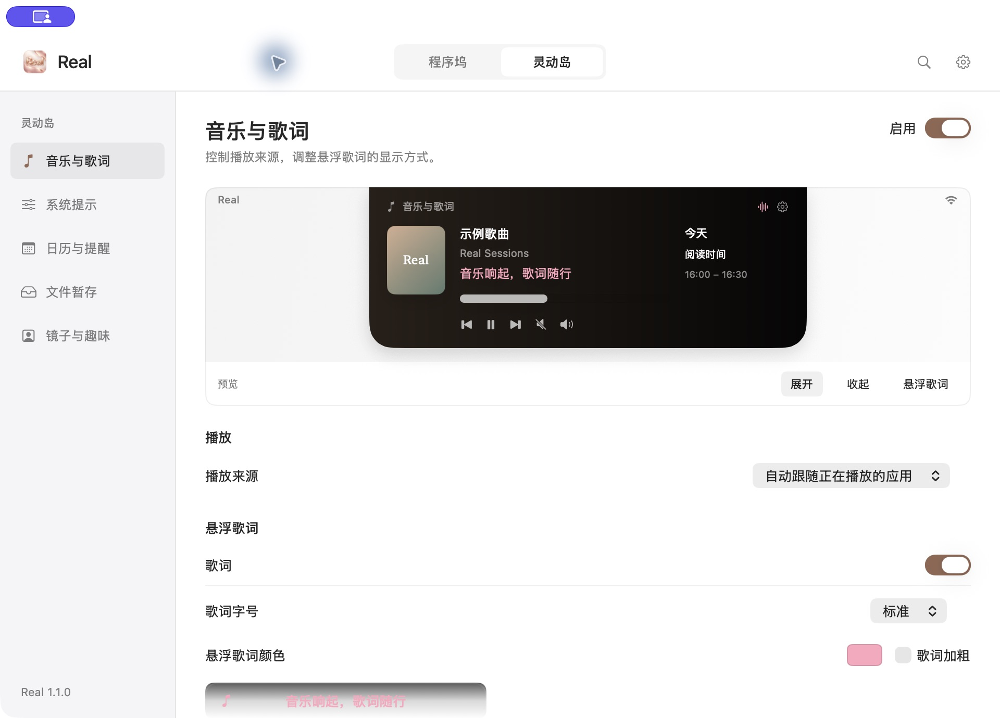
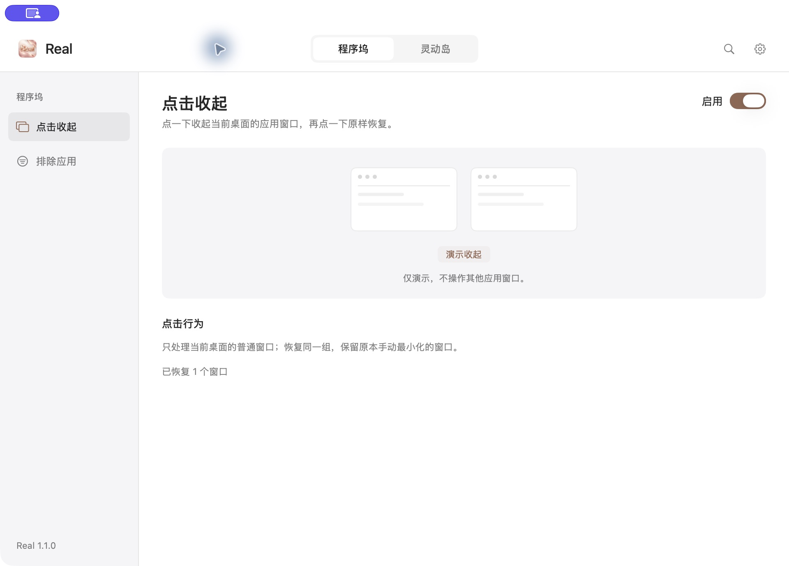

<p align="center">
  
</p>

<h1 align="center">Real</h1>

<p align="center">点一下收起窗口，让音乐与日常工具留在手边。</p>

<p align="center">
  <a href="https://github.com/daiqingyuan/Real/releases/latest/download/Real-1.1.1-AppleSilicon.dmg"><strong>下载 Real · DMG</strong></a>
  &nbsp;·&nbsp;
  <a href="https://github.com/daiqingyuan/Real/releases/latest/download/Real-1.1.1.zip">ZIP 下载</a>
  &nbsp;·&nbsp;
  <a href="https://github.com/daiqingyuan/Real/releases">版本记录</a>
</p>

<p align="center">Apple 芯片 Mac · macOS 14 及以上 · 当前版本 1.1.1（构建 4）</p>

Real 将程序坞窗口收起与恢复、灵动岛和同步歌词放进一个 Mac 桌面工具。平时在后台运行，需要时再打开设置；程序坞和菜单栏图标是否显示，由你决定。

## 三步开始使用

1. **下载安装包。** 点击上方「下载 Real · DMG」。当前安装包仅适用于 Apple 芯片 Mac，暂不提供 Intel 版本。更新前，请先在旧版 Real 中选择「退出 Real」。
2. **放进应用程序。** 打开 DMG，将 **Real.app 拖到「应用程序」**，推出磁盘映像，再从「应用程序」打开 Real。使用 ZIP 的话，解压后同样将 Real.app 移入「应用程序」。替换更新会保留已有设置。
3. **完成首次授权。** 按应用内引导和 macOS 提示允许所需权限；已经允许的项目会跳过。也可稍后从右上角齿轮进入「运行与权限」继续设置。

**首次打开被 macOS 阻止？** 当前分发包使用本地代码签名，尚未经过 Apple Developer ID 签名及公证。确认文件来自本仓库后，按 [Apple 官方打开应用说明](https://support.apple.com/zh-cn/102445) 操作；无需关闭系统安全保护。

## 看看 Real

### 音乐与歌词



真实应用的设置窗口，可调整歌词颜色、字号、加粗与背景。右侧灵动岛是界面内的演示内容，并非当前播放状态。

### 程序坞点击收起



真实应用的程序坞设置页。页面中的窗口示意用于解释收起与恢复，不是其他应用窗口的实时画面。

## 它能做什么

| 功能 | 日常怎么用 |
| --- | --- |
| **程序坞点击收起** | 点前台应用的图标，收起当前桌面的普通窗口；再点恢复同一组，保留原本手动最小化的窗口。可按应用设置排除项。 |
| **音乐与同步歌词** | QQ 音乐与网易云音乐自动跟随最近开始播放的来源；默认粉色歌词，长句滚动，鼠标悬停自动避让。支持颜色、字号、加粗、背景及单曲同步微调。 |
| **灵动岛里的随手工具** | 音量与亮度提示、日历与提醒、文件暂存、镜子与闲置显示，按需要启用。保留系统播放器、YTMDesktop 连接及五个播放控制位置的设置。 |
| **按习惯运行** | 紧凑原生设置、设置搜索、登录启动、图标显示选择、首次授权引导、运行自检、诊断导出和应用内卸载。界面支持中文、英语、日语、俄语及跟随系统。 |

## 哪些权限需要开

| 权限 | 什么时候需要 |
| --- | --- |
| **辅助功能** | 程序坞窗口收起与恢复需要；也用于播放器状态读取与控制、硬件按键响应。 |
| **屏幕录制** | 程序坞功能需要，用于识别当前桌面的窗口。声音频谱仅在手动开启时启动捕获。 |
| **输入监控** | 按需允许；若系统仍阻止程序坞点击或硬件按键监听，可补充开启。 |
| **摄像头、日历与提醒事项** | 使用对应功能时再授权，不需要一次全部开启。摄像头仅在打开镜子时运行。 |

系统授权仍需你在 macOS 中确认，Real 不会替你打开权限开关。

## 常用操作

- **收起和恢复窗口：** 先点一下应用窗口，让它处于最前面，再点它的程序坞图标。再次点击可恢复刚才收起的那一组。
- **切换音乐来源：** 在 QQ 音乐或网易云音乐中开始播放。选择「自动跟随正在播放的应用」时，Real 会跟随最近开始播放的来源；也可在音乐设置中固定来源。
- **让歌词避开鼠标：** 把鼠标移到灵动岛下方的悬浮歌词上，歌词会自动收起；移开后再显示。颜色和显示细节可在「音乐与歌词」里调整。
- **打开偏好设置：** 点击 Real 窗口右上角的齿轮；放大镜或 `⌘F` 可搜索设置。登录启动在「通用」，程序坞与菜单栏图标在「图标显示」。
- **保持后台运行：** 关闭设置窗口或隐藏图标都不会退出。开启登录启动后，登录会安静启动，不弹设置窗口；图标选择会保留。若两个图标都隐藏了，从「应用程序」重新打开 Real 即可回到设置。
- **退出或卸载：** 齿轮 →「关于 Real」中可选择「退出 Real」或「卸载 Real…」。卸载时可选择是否保留设置，文件暂存架中的原文件不会删除。

<details>
<summary><strong>遇到问题？展开查看排查方法</strong></summary>

### 点击程序坞没有反应

先确认「程序坞 → 点击收起」已启用，目标应用没有被排除，并且它的普通窗口位于当前桌面、处于前台。再打开「偏好设置 → 运行与权限」检查后台与权限状态；缺少权限时按引导处理，后台监听异常时可使用页面提供的修复按钮。

全屏窗口、对话框以及其他桌面的窗口不属于普通窗口组。不同应用的特殊窗口实现和后续更新可能影响兼容性。

### 音乐或歌词没有显示

确认「音乐与歌词」模块和歌词已启用，在播放器中开始播放，并检查播放来源选择。查看「运行与权限」中的播放器、歌词状态；歌词匹配与可用性取决于歌曲和服务。若只是时间略有偏差，可在歌词的更多设置中调整本曲同步，不会改变播放进度。

主歌词源暂时失败时，Real 会自动尝试备用检索；各来源分别遵守自己的冷却时间并有限重试，能先恢复的来源无需等待另一方。展开灵动岛的歌词页，也可以点击「重试歌词」；手动重试仍遵守各来源的限流时间。

确认未找到歌词的结果会短暂缓存 **60 秒**，到期后再次加载同一曲目可重新查询。确实没有匹配歌词或属于纯音乐时，仍会显示对应状态，不会把服务故障直接当作没有歌词，也不保证每首歌都能找到同步歌词。

### 更新后仍提示缺少权限

退出旧版，确认从「应用程序」打开的是当前 Real，再检查系统设置中的授权。不要同时运行多个 Real 副本；自行构建或重新签名的应用可能需要重新授权。

### 需要反馈问题

在「运行与权限」点击「导出诊断」，保存文件后，连同 Real 版本、macOS 版本和复现步骤一起反馈。导出不会自动上传；分享前可以先查看文件内容。

</details>

<details>
<summary><strong>开发者：源码构建与验证范围</strong></summary>

需要 Apple 芯片 Mac、macOS 14 及以上、Xcode 及其命令行工具。仓库包含原生 Swift 源码、测试、资源，以及固定版本的 MediaRemoteAdapter 预编译框架。

```sh
./build.sh --ad-hoc
```

输出为 `build/real-debug-adhoc.zip`。此模式使用临时签名，适合开发验证，不继承已安装分发版身份对应的系统授权。完整原生自测需要桌面会话；`--headless-tests` 会明确跳过原生滑块测试。

可单独运行歌词离线回归：

```sh
zsh Scripts/test-lyrics.sh
```

脚本用合成数据拦截 QQ、网易云和备用目录的全部测试请求，不访问真实歌词服务、不操作播放器。`build.sh` 打包前也会自动要求这套回归通过。

默认 `./build.sh` 使用开发机上的本地签名证书；其他电脑通常没有该证书，应使用 `--ad-hoc`。仓库不包含私钥、个人偏好、播放器令牌或本机调试记录。

**当前验证范围：** 本轮通用歌词修复通过原生构建、自测及全拦截合成回归，覆盖两源服务失败、独立冷却时间、缓存到期、取消与有限重试；使用 QQ 音乐的两首歌曲验证了实际读取与应用界面。1.1.1（构建 4）发行更新版本和签名元数据后重新打包，功能代码与上述已验收构建一致。本轮未重新执行网易云实际播放、程序坞真实鼠标点击、重启或多个物理显示器测试。

</details>

## 第三方组件与许可

组件来源、许可与保留声明见 [THIRD_PARTY.md](THIRD_PARTY.md)、[Resources/Licenses](Resources/Licenses) 及所附框架资源。各组件适用其对应许可，项目不将全部代码声明为同一项许可证。
